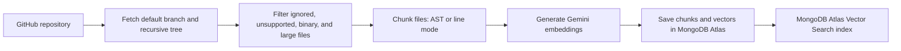
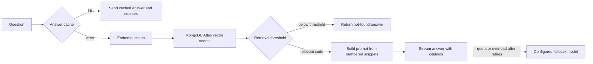
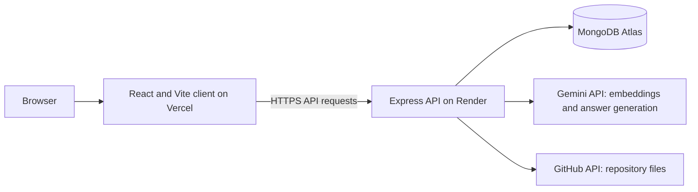

# RepoMentor

RepoMentor answers questions about GitHub repository code and cites the files and line ranges it used.

[](https://github.com/Adarshsharma10/RepoMentor/actions/workflows/ci.yml)

**Live demo:** https://repo-mentor-five.vercel.app/ — Free hosting may take up to a minute to wake up, and the free model quota can run out.

## What it does

RepoMentor indexes a snapshot of a GitHub repository and stores code chunks and their embeddings in MongoDB Atlas. You can ask questions about a ready repository, and the server retrieves relevant chunks before asking Gemini to answer from that context. Answers include numbered citations that open the matching file and line range. A cached grounded answer can be reused for a repeated question.

### Features

- Register and sign in with email and password.
- Add, list, search, ask about, and delete repositories you own in RepoMentor.
- AST-aware chunks for JavaScript, TypeScript/TSX, and Python by default; choose line chunks with `CHUNKING_MODE=lines`.
- Search for closest code matches and ask questions with clickable citations.
- Stream answers as they are generated; stop generation and keep an unsaved partial answer.
- Reopen a repository to see its latest saved questions and answers.
- Cache grounded answers and enforce per-user and server-wide request limits.

## How it works

### Indexing a repository



### Answering a question



The fallback model is optional and is attempted only for eligible provider failures. A streaming fallback is only possible before any answer text has been sent.

## Architecture

The diagram shows the intended hosted arrangement described in this guide; this repository does not include provider deployment configuration.



## Tech stack

| Area | Technology |
| --- | --- |
| Client | React 18, Vite, CSS |
| API | Node.js ES modules, Express |
| Database and vector retrieval | MongoDB Atlas, Mongoose, Atlas Vector Search |
| Authentication | JWT bearer tokens, bcryptjs |
| Repository access | Octokit |
| Chunking | web-tree-sitter with JavaScript, TypeScript/TSX, and Python WASM grammars; line-based fallback |
| Embeddings and answers | Google GenAI SDK, Gemini |
| Streaming | Server-Sent Events over `fetch` |
| Continuous integration | GitHub Actions workflow at `.github/workflows/ci.yml` |

## Evaluation

The evaluation script checks 20 positive questions and 5 off-topic questions against one selected, ready repository index. It uses top-5 retrieval by default, reports hit rate, mean reciprocal rank (MRR), precision@5, and negative-query scores. The table below reports the supplied results for the same repository snapshot in each mode.

| Chunking mode | Hit rate | MRR | Precision@5 |
| --- | ---: | ---: | ---: |
| Lines mode | 95% | 0.925 | 0.43 |
| AST mode | 100% | 0.942 | 0.47 |

The test set is small and the index grows as the project grows, so treat the results as indicative, not as a benchmark.

## Run locally

### Prerequisites

- Node.js 22 and npm.
- A MongoDB Atlas database with Atlas Vector Search available.
- A Gemini API key for embeddings and answer generation.
- A GitHub token is optional; without it, Octokit uses unauthenticated GitHub API access.

### Install and configure

Clone the repository, then run these commands from its root. Replace `<repository-url>` with the URL of this project:

```sh
git clone <repository-url>
cd RepoMentor
npm ci
```

Copy the example files and edit `server/.env` with your Atlas URI, a random `JWT_SECRET` of at least 32 characters, and your `GEMINI_API_KEY`. `LLM_MODEL` is required for answer generation.

PowerShell:

```powershell
Copy-Item server/.env.example server/.env
Copy-Item client/.env.example client/.env
```

macOS or Linux:

```sh
cp server/.env.example server/.env
cp client/.env.example client/.env
```

### Set up MongoDB Atlas

1. Create a database named `repomentor` and set `MONGODB_URI` to its connection string. Create a database user with access limited to this database.
2. In Atlas Search / Vector Search, create an index named `chunk_vector_index` on the `chunks` collection.
3. Use this index definition:

```json
{
  "fields": [
    { "type": "vector", "path": "embedding", "numDimensions": 768, "similarity": "cosine" },
    { "type": "filter", "path": "repoId" }
  ]
}
```

The application expects this index; it does not create it automatically.

### Run and check

Start the API and client together:

```sh
npm run dev
```

Open `http://localhost:5173`, register or sign in, add a GitHub repository, wait for indexing to finish, then ask a question.

Run checks from the project root:

```sh
npm test
npm run lint
npm run build
```

The API listens on port `4000` by default. `GET /api/health` reports API and database readiness.

## Environment variables

### Server (`server/.env`)

| Name | Purpose | Required? | Example |
| --- | --- | --- | --- |
| `PORT` | HTTP server port | Optional | `4000` |
| `NODE_ENV` | Runtime mode and production CORS behavior | Optional | `development` |
| `MONGODB_URI` | MongoDB connection string | Required | `mongodb+srv://.../repomentor` |
| `JWT_SECRET` | Signs and verifies bearer tokens; at least 32 characters | Required | `<random-secret>` |
| `JWT_EXPIRES_IN` | Token lifetime | Optional | `1d` |
| `CORS_ORIGIN` | Comma-separated allowed browser origins; required in production | Production required | `https://your-client.example` |
| `REGISTRATION_OPEN` | Enables or closes account registration | Optional | `true` |
| `GLOBAL_DAILY_ASK_LIMIT` | Server-wide model-call limit per UTC day | Optional | `200` |
| `MAX_CHUNKS_PER_REPO` | Maximum chunks accepted for one repository; defaults to `150` | Optional | `150` |
| `GITHUB_TOKEN` | Authenticates Octokit requests and can raise GitHub API limits | Optional | Empty or `<token>` |
| `GEMINI_API_KEY` | Authenticates Gemini embedding and answer requests | Needed for indexing and answers | `<api-key>` |
| `LLM_PROVIDER` | Answer provider; currently only Gemini is implemented | Optional (`gemini` default) | `gemini` |
| `LLM_MODEL` | Gemini answer model name | Required for answers | `<model-name>` |
| `LLM_FALLBACK_MODEL` | Optional alternate model after eligible quota or server failures | Optional | Empty or `<model-name>` |
| `RETRIEVAL_MIN_SCORE` | Minimum vector score accepted for a specific answer | Optional (`0.78` default) | `0.78` |
| `CHUNKING_MODE` | Selects AST-aware or line-based chunking | Optional (`ast` default) | `ast` |
| `ASK_RATE_LIMIT_PER_HOUR` | Per-user ask and stream requests allowed per hour | Optional (`20` default) | `20` |

### Client (`client/.env`)

| Name | Purpose | Required? | Example |
| --- | --- | --- | --- |
| `VITE_API_URL` | API base URL included in the client build; empty uses the Vite development proxy | Optional locally; set for a separately hosted client | `https://your-api.example` |

## Deployment

The deployment instructions below describe a Vercel client and Render API setup. Hosting accounts and service settings are not configured in this repository.

### MongoDB Atlas

Create the `repomentor` database, create a database user limited to it, allow the API host to connect, and create the `chunk_vector_index` described above. Put the connection string in the server's `MONGODB_URI` variable.

### Render API

Create a Node web service from the repository root. Use:

| Setting | Value |
| --- | --- |
| Build command | `npm ci --omit=dev` |
| Start command | `npm start --workspace server` |
| Health check path | `/api/health` |

Set `NODE_ENV=production`, `MONGODB_URI`, `JWT_SECRET`, `CORS_ORIGIN`, `GEMINI_API_KEY`, and `LLM_MODEL`. Add other server variables from the table above as needed. Render provides `PORT` to the service.

### Vercel client

Set the Vercel project root directory to `client`, use `npm run build` as the build command, and `dist` as the output directory. Set `VITE_API_URL` to the deployed Render API base URL before building.

After the Vercel URL is known, add its exact origin to the Render `CORS_ORIGIN` value (comma-separated if there are multiple allowed origins). The browser will otherwise be blocked from making API requests.

## API reference

All repository endpoints require a JWT bearer token. `/api/health` and the two auth endpoints do not require a token; `/api/auth/me` does.

| Method | Path | Auth | Purpose |
| --- | --- | --- | --- |
| `GET` | `/api/health` | No | Return API and MongoDB connection state. |
| `POST` | `/api/auth/register` | No | Create an account and return a token. |
| `POST` | `/api/auth/login` | No | Sign in and return a token. |
| `GET` | `/api/auth/me` | Yes | Return the signed-in account. |
| `POST` | `/api/repos` | Yes | Add and index a GitHub repository. |
| `GET` | `/api/repos` | Yes | List the signed-in user's repositories. |
| `GET` | `/api/repos/:id` | Yes | Get one owned repository and its status. |
| `DELETE` | `/api/repos/:id` | Yes | Delete an owned repository and its stored data. |
| `POST` | `/api/repos/:id/search` | Yes | Return closest matching chunks for a query. |
| `POST` | `/api/repos/:id/ask` | Yes | Generate and save a non-streamed answer with sources. |
| `POST` | `/api/repos/:id/ask/stream` | Yes | Stream sources and answer events using SSE. |
| `GET` | `/api/repos/:id/messages` | Yes | Return the latest 20 saved messages for an owned repository. |

## Security and limits

- Every repository route requires authentication and checks that the repository belongs to the signed-in user.
- Login and registration are limited to 10 requests per 15 minutes per IP. Adding repositories is limited to 5 per hour per user; search is limited to 30 requests per minute per user; ask and streamed ask share the configurable per-user hourly limit.
- The server-wide model-call cap defaults to 200 per UTC day. Grounded cached answers do not call the model or consume this cap; cached entries expire after 7 days.
- Retrieved repository snippets are labeled as untrusted data in the prompt. Code fences are lengthened when needed so source code containing backticks stays inside its snippet fence.
- Citation markers are retained only when they refer to a retrieved source number. This validates the citation reference, not the factual accuracy of the model's claim.
- Errors returned to clients use safe public messages. API keys and database credentials belong in environment variables, never in committed source files.

## Project structure

```text
client/       React application, styles, API helpers, and Vite config.
server/src/   Express API, models, routes, middleware, and services.
server/test/  Node.js unit tests that do not require live MongoDB or Gemini.
server/scripts/ Evaluation command-line script.
server/eval/  Retrieval evaluation questions and generated results.
.github/      CI workflow.
```

## Limitations and Roadmap

### Limitations

- Indexing stores a snapshot from when the repository is added; there is no automatic refresh when GitHub changes.
- Public repositories are the documented path. Any private-repository access would use only the server-wide `GITHUB_TOKEN`, not per-user authorization.
- Indexing runs as part of the add-repository HTTP request, so large repositories can take time and may hit provider limits.
- Free hosting can have cold starts, and free Gemini quotas can run out.
- A configured fallback model is optional; if it is not set or also fails, the answer request returns a safe error.

### Roadmap

- GitHub webhooks for re-indexing changed repositories.
- A job queue for background indexing.
- GitHub login and per-user access to private repositories.
- Hybrid keyword and vector search.
